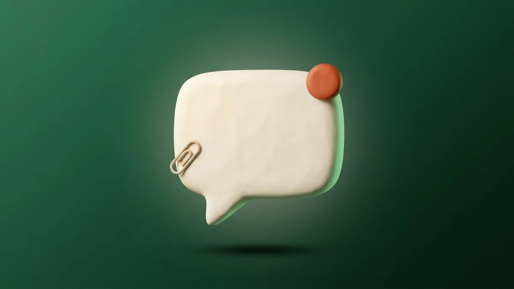

  

# Live Chat

A small live chat for Cactus sites that does what it says on the tin and very
little else. No chat server to run, no third-party widget, nothing to provision:
conversations live in your site's own database and attachments in your site's
own media storage (Backblaze on most sites).

## What it does

- **A chat bubble on your site.** Add the *Live Chat* block to your header or
  footer layout and it appears in the bottom corner of every page using it.
- **Bubbles while the chat is shut.** If we reply while the visitor has the
  window closed, the message pops up above the bubble, the way a text does on a
  phone. The same happens for you when a visitor writes in.
- **Browser notifications.** Once a visitor has sent a message, the chat asks
  whether they would like a notification when we reply - including after they
  have closed the tab, in browsers that support it.
- **Attachments.** Pictures, PDFs and office documents up to 4MB each, kept
  privately in your media storage and never shown in the media library.
- **End chat and email a transcript.** Visitors can end the chat whenever they
  like and, if they tick the box, have a copy emailed to them, attachments
  linked. Once a chat has ended, from either side, it is ended: nobody can add
  to it, and the visitor starts a fresh one if they have more to say.
- **Name and email whenever suits.** The optional name and email boxes stay put
  for the whole chat, so a visitor who decides halfway through that they would
  like a reply by email can still leave one.
- **Keeps itself up to date.** The admin chat window never needs a reload:
  new messages, chats starting and ending, unread counts, who is on the site
  and the Online switch all update on their own, at once when you come back to
  the tab, and anything you do shows straight away in every other tab you have
  it open in. "Typing…" shows both ways, your last reply says Seen once the
  visitor has had it on screen, and each chat says how long it has been waiting.
- **A reply box that keeps up.** Drafts kept per chat, words typed while a
  message is sending kept too, screenshots pasted or files dropped straight in,
  and a New message button instead of being yanked down while you scroll back.
- **Answer from anywhere.** From *Inbox > Live chat* in the admin, from the
  bubble on the site itself while you are signed in, or from the Unified Inbox
  if you have it installed - new chats land there the moment they are sent.
- **See who is on the site.** Everybody browsing who said yes to the Live chat
  cookies is listed while they are here, chatting or not: the page they are on,
  the pages they came through and, with the shop, what is in their basket. Say
  hello first and the chat pops up on their screen.
- **Messages we send first.** Optional, off by default, and only while you are
  online and the visitor has no chat going. A welcome message goes to a visitor
  who has been on the site a set number of seconds without writing to us, and a
  basket message goes a set number of seconds (0 = straight away) after their
  first add. Each is sent once per visitor. A chat that is nothing but one
  of these leaves your chat list when the visitor leaves the site without
  answering, and comes back if they return.
- **Your own name.** A cog in the chat header lets each colleague choose the
  name visitors see on their replies; left empty, it is the first name on their
  account.
- **Asks first.** Declares a *Live chat* category for your cookie banner. Once
  the banner carries it, a visitor is asked before they can chat (one button,
  live chat only), and anybody who said no is shown the cookie settings when
  they try to send something.
- **Admin alerts.** Waiting chats light the admin bell, and buzz anyone who has
  desktop alerts switched on.
- **Tidies up after itself.** Chats with nothing said in them for longer than
  you choose (12 months by default) are deleted overnight, files and all.

## Settings

*Settings > Live Chat*: switch the bubble on or off, its label, the greeting,
which corner it sits in, whether visitors may email themselves a transcript,
how long chats are kept, and whether to list who is on the site. It also tells
you if your cookie banner is missing the Live chat switch.

## Permissions

| Key | Lets somebody |
| --- | --- |
| `chat.view` | read chats, see the admin bubble on the site and who is on the site |
| `chat.reply` | reply to and end chats, and message a visitor first |
| `chat.manage` | change settings and delete chats |

## How it works (for developers)

- Module name `chat`, table prefix `chat_`. Distinct from the Chatwoot-powered
  `live-chat` module, so the two can sit side by side while a site moves over.
- "Live" is polling, which is the honest shape of it on serverless hosting: the
  visitor's widget asks every 3 seconds while open and 12 while shut, the admin
  views every 3-5 seconds, all backing off when the tab is hidden. Typing
  rides along on those same polls (`?typing=1`, migration `009_typing.sql`),
  so it costs no extra requests.
- A visitor proves a chat is theirs with a secret their browser was handed when
  the chat began (sent as the `x-chat-visitor` header). Only its hash is stored.
  No accounts. Where the cookie banner carries the `live-chat` category,
  nothing is kept in the browser until the visitor says yes to it.
- Visitors who said yes check in to `/api/m/chat/widget/presence` as they move
  around (and every 30 seconds while the tab is in front), claimed with their
  own `x-chat-presence` secret. The basket is read from the shop's own
  `localStorage` copy (ids and quantities) and named from `shp_products` on the
  server, when that table exists. A closing tab says goodbye to
  `/api/m/chat/widget/leave`, so the visitor leaves the list at once rather
  than 90 seconds later. Trails are deleted 7 days after the visitor
  was last seen, or at once if they withdraw consent.
- Attachments are written under `media/chat/<conversation>/` with an
  unguessable key and served only through `/api/m/chat/attachments/<id>`,
  either to an admin with `chat.view` or via a signed link.
- Visitor notifications use Web Push with the site's own signing keys, through
  a service worker served at `/api/m/chat/widget/sw` (scoped to that folder, so
  it takes over no page of the site).
- Publishes `core.conversation-provider` and announces every new message with
  `core.conversation-arrived`, which is how the Unified Inbox gets it at once.
- Needs `ENCRYPTION_KEY`. `CRON_SECRET` runs the nightly retention sweep.
